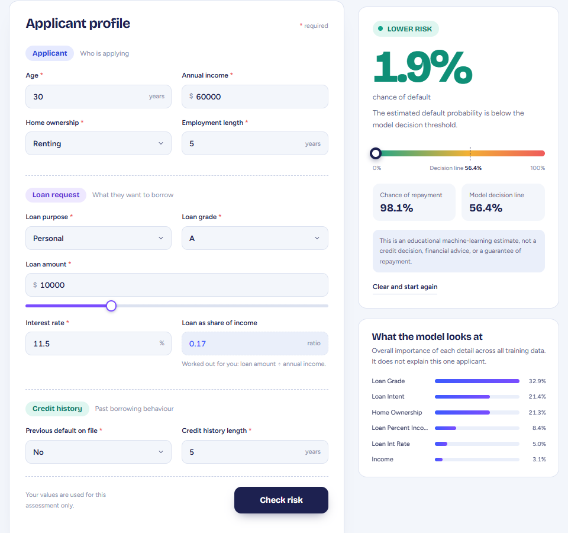
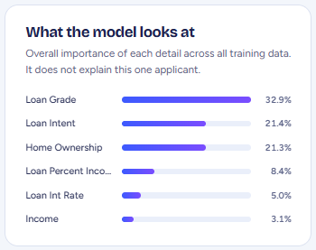

# Credit Ledger – Credit Risk Assessment

A full-stack credit-risk assessment demonstration built with **FastAPI**, **scikit-learn**, **XGBoost**, and a responsive HTML/CSS/JavaScript interface. It uses a calibrated classification pipeline trained on the included credit-risk dataset to estimate the probability of a recorded loan default.

> **Responsible-use note:** This is an educational portfolio project. Its output is not a credit decision, financial advice, or a guarantee of repayment. It must not be used as the sole basis for real lending decisions.

## Features

- Applicant, loan, and credit-history input form.
- Calibrated XGBoost pipeline loaded from a saved model artifact.
- Default and repayment probability estimates.
- Configurable classification threshold loaded from `best_threshold.pkl`.
- Input validation and clear API error responses.
- Global model-level feature importance when the saved pipeline exposes compatible XGBoost estimators.
- FastAPI health and model-information endpoints.
- Responsive interface with a bright, light indigo-and-spectrum palette.

## Screenshots



The result card shows the default chance, the repayment chance, and where the applicant sits against the model's decision line (56.4%).



## Technology

| Layer             | Tools                     |
| ----------------- | ------------------------- |
| Frontend          | HTML, CSS, JavaScript     |
| Backend           | Python, FastAPI, Pydantic |
| Machine learning  | scikit-learn, XGBoost     |
| Data              | Pandas, NumPy             |
| Model persistence | joblib, pickle            |
| API testing       | pytest, HTTPX             |

## Project structure

```text
Credit_Risk_Assessment/
├── docs/
│   ├── result.png
│   └── model_info.png
├── static/
│   ├── index.html
│   ├── style.css
│   └── script.js
├── tests/
│   └── test_api_contract.py
├── Credit_Risk.ipynb
├── credit_risk_dataset.csv
├── credit_risk_model.pkl
├── best_threshold.pkl
├── MODEL_ARTIFACTS.txt
├── main.py
├── pytest.ini
├── requirements.txt
├── runtime.txt
├── .gitignore
└── README.md
```

## Run locally on Windows

Use **Python 3.11**. The model artifact was serialized with scikit-learn 1.6.1, so keep the pinned dependency versions in `requirements.txt`.

```powershell
# 1. Open this project folder in VS Code, then open Terminal
py -3.11 -m venv .venv

# 2. Activate the virtual environment
.\.venv\Scripts\Activate.ps1

# If PowerShell blocks activation, run this once for the current terminal:
# Set-ExecutionPolicy -Scope Process -ExecutionPolicy Bypass

# 3. Install dependencies
python -m pip install --upgrade pip
pip install -r requirements.txt

# 4. Start the application
uvicorn main:app --reload
```

Open **http://127.0.0.1:8000** for the application and **http://127.0.0.1:8000/docs** for interactive API documentation.

Keep `credit_risk_model.pkl` and `best_threshold.pkl` in the same directory as `main.py`.

## Run the tests

With the virtual environment active, run this from the project folder:

```powershell
pytest -q
```

The tests check the input validation and call the real `/health` and `/predict` endpoints with the saved model. You may see a warning from XGBoost about the model file version. It is only a notice and does not affect the results.

## Deploy on Render

The FastAPI app serves both the website and the API, so only **one** Render web service is needed.

- Build command: `pip install -r requirements.txt`
- Start command: `uvicorn main:app --host 0.0.0.0 --port $PORT`
- Health check path: `/health`
- Environment variable: `PYTHON_VERSION` = `3.11.9` (the model was saved with scikit-learn 1.6.1, so keep the pinned versions)

Render's free tier goes to sleep when unused, so the first request after a break can take up to a minute.

## API

### `GET /health`

Returns whether the model artifacts loaded successfully.

### `GET /model-info`

Returns the model name, decision threshold, input feature schema, and global feature-importance summary when available.

### `POST /predict`

Example request:

```json
{
  "person_age": 30,
  "person_income": 60000,
  "person_home_ownership": "RENT",
  "person_emp_length": 5,
  "loan_intent": "PERSONAL",
  "loan_grade": "A",
  "loan_amnt": 10000,
  "loan_int_rate": 11.5,
  "loan_percent_income": 0.1667,
  "cb_person_default_on_file": "N",
  "cb_person_cred_hist_length": 5
}
```

The `loan_percent_income` value should be the loan amount divided by annual income. The browser form calculates this field automatically.

The response includes default probability, repayment probability, threshold, and a model risk category. The category is a model classification only; it is not a lending approval or rejection.

## Machine-learning workflow

The notebook documents the original workflow:

1. Exploratory data analysis and data validation.
2. Duplicate and implausible-record filtering.
3. Stratified train/test split.
4. Numeric imputation and categorical one-hot encoding.
5. Logistic Regression baseline and XGBoost experimentation.
6. Hyperparameter search and probability calibration.
7. Threshold selection and SHAP analysis in the notebook.
8. Export of the calibrated model and threshold for API inference.

The deployed API uses the saved preprocessing/model pipeline so input transformation remains inside the trained estimator.

## Threshold note

The original notebook used an incorrect F1 expression (`precision - recall`) and selected the threshold from the uncalibrated model, while the exported artifact was calibrated. The notebook and `best_threshold.pkl` in this package have been corrected to calculate F1 using the calibrated model's probabilities. The threshold currently included is approximately **0.5639**.

For a rigorous final model report, threshold selection should be performed on a separate validation set, followed by one final evaluation on an untouched test set. The threshold supplied here was recalculated using the notebook's existing held-out split; therefore, do not present metrics measured on that same split as an unbiased final test after threshold optimization.

## Explainability

The interface shows global feature importance aggregated across available calibrated XGBoost folds. This is a model-level summary, not an individual applicant explanation and not evidence of causation. The notebook contains SHAP analysis cells for deeper investigation. If the saved estimator's internal structure does not expose feature importances under the installed versions, the interface reports that the information is unavailable rather than inventing values.

## Limitations

- Dataset values and model behaviour reflect the source dataset and may not generalize to current lending populations.
- Historical labels can encode bias.
- Probability calibration and threshold choice depend on the data split and deployment population.
- Global feature importance does not explain a single prediction.
- This project is intended for learning and demonstration, not production lending.

## Future improvements

- Add a separate validation split for threshold selection and a final untouched test evaluation.
- Add model monitoring for feature drift and calibration drift.
- Add individual-level explanations with a verified SHAP implementation.
- Add authentication and audit logging if the application is extended beyond a local demo.
- Add CI checks and deployment configuration after verifying the target hosting platform.
# Credit-Risk-Assessment
